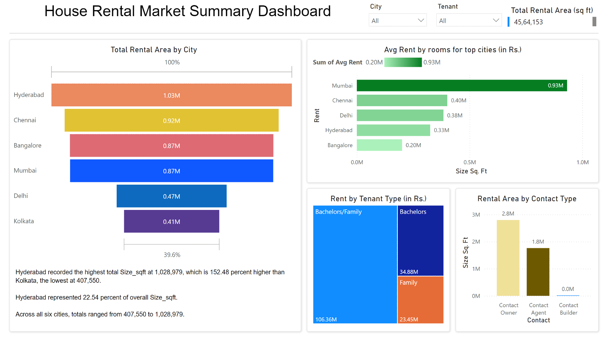
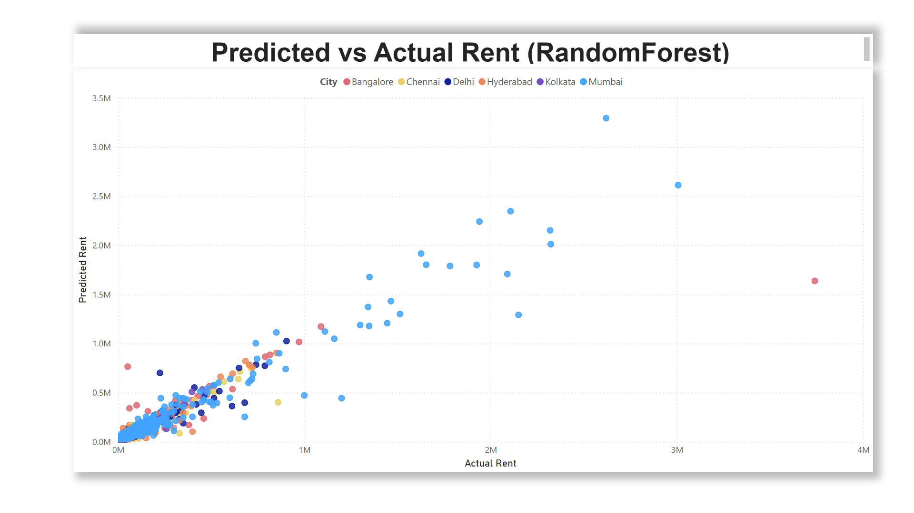

# House Rent Analysis in Microsoft Fabric

An end-to-end data project built in **Microsoft Fabric**: ingesting a raw CSV, cleaning it with **PySpark**, storing it as **Delta tables** in a Lakehouse, analysing it with **Spark SQL**, training a **Random Forest** model to predict rent, and presenting the results in **Power BI**.

Built as the final project for *Unlocking the Power of Big Data* (Master in Business Analytics & Data Science, EU Business School, Munich – December 2025).



## Business question

How do city, property size, number of rooms and tenant type affect rental prices across India's major cities, and can rent be predicted from these features?

## Dataset

- **Source:** [House Rent Prediction Dataset](https://www.kaggle.com/datasets/iamsouravbanerjee/house-rent-prediction-dataset) on Kaggle
- **Size:** 4,746 rental listings from 6 Indian cities (Mumbai, Bangalore, Delhi, Chennai, Hyderabad, Kolkata)
- **Fields:** rent, size (sq ft), BHK, bathrooms, city, locality, furnishing status, preferred tenant, point of contact

## Workflow

| Step | What was done | Tools |
|---|---|---|
| 1. Ingestion | Uploaded the raw CSV to the Fabric Lakehouse and loaded it into a Spark DataFrame | Microsoft Fabric, OneLake |
| 2. Cleaning | Trimmed text fields, cleaned numeric columns, standardised tenant categories, checked for nulls and invalid values, removed 34 duplicates (4,746 → 4,712 rows) | PySpark |
| 3. Storage | Saved cleaned, ML-ready and aggregated data as Delta tables | Delta Lake |
| 4. SQL analysis | Average and median rent by city; average rent by BHK for the top 5 cities | Spark SQL |
| 5. Machine learning | Random Forest regression to predict rent (see below) | PySpark MLlib |
| 6. Dashboard | Rental market summary and predicted-vs-actual rent visuals | Power BI |

### Delta tables created

- `cleaned_house_rent` – cleaned listings
- `cleaned_house_rent_ml` – feature table for modelling
- `avg_rent_by_city` / `agg_rent_by_city` – city-level averages and medians
- `rent_by_bhk_top_cities` – rent by number of rooms in the top 5 cities
- `rf_predictions` – actual vs predicted rent for Power BI

## Machine learning model

- **Model:** Random Forest Regressor (50 trees, max depth 8)
- **Features:** BHK, bathrooms, size (sq ft), city, furnishing status, preferred tenant (categorical features one-hot encoded)
- **Train / test split:** 3,811 / 901 rows
- **Results:** R² = **0.70**, RMSE ≈ ₹30,150

The model explains about 70% of the variation in rent. Errors are largest for very high-rent Mumbai listings, which are rare in the data.



## Key findings

- Hyderabad has the largest total rental area in the dataset (about 22.5% of all square footage).
- Mumbai has by far the highest average rents for comparable room counts.
- Listings open to both bachelors and families make up the largest share of total rent.

## Repository contents

```
01_HouseRent_Ingestion_Cleaning.ipynb   PySpark notebook: ingestion, cleaning, Delta tables, ML model
sql/avg_rent_by_city.sql                Spark SQL: average and median rent by city
sql/rent_by_bhk_top_cities.sql          Spark SQL: average rent by BHK in the top 5 cities
House_Rent_Dataset.csv                  Raw dataset
Dashboard_1.png                         Power BI: rental market summary
Dashboard_2.png                         Power BI: predicted vs actual rent
```

## Author

**John Sudhan Emmanuel** – [LinkedIn](https://www.linkedin.com/in/john-sudhan-15801013b/) · [Tableau Public](https://public.tableau.com/app/profile/john.sudhan/vizzes)
